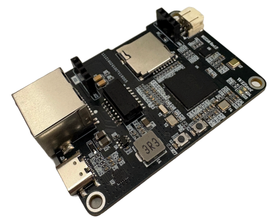

# WIZ-Cam

<p align="center">
  
</p>

WIZ-Cam is MicroPython-powered board running on **W55MH32**  with an **OV2640** sensor and an
**ICS-43434** I2S microphone. Video is captured straight off the sensor's DVP bus into RAM by DMA and sent out
over Ethernet through the chip's built-in W5500 TCP/IP core, either as an **HTTP MJPEG stream** or as **RTSP/RTP with
audio**. Audio also runs the other way: a PC can stream PCM to the board and have it played through the on-board
amplifier.

Nothing here is a general-purpose library: the capture path drives TIM1, DMA1 and the GPIO ports directly, so the
pin assignments and register addresses are specific to W55MH32.

## Hardware

### Specification

| | |
|---|---|
| MCU | W55MH32 (Cortex-M3 @ 216 MHz, integrated W5500 TOE on SPI2) |
| Sensor | OV2640, DVP 8-bit, JPEG output |
| Microphone | ICS-43434, I2S (SPI3) |
| Speaker amp | MAX98357A, on the **same** I2S bus as the microphone |

### Wiring

OV2640
- VSYNC on`PC5`
- HREF on `PA8` (TIM1_CH1, used as the counter gate)
- PCLK on `PA12` (TIM1_ETR),
- D0-D7 on `PA0-PA7`
- SCCB (I2C) on `PB6`/`PB7`

Audio
- SCK on `PB3`, WS on `PA15`, SD on `PB5`

The microphone and the amplifier share those three pins. The chip has only **one** I2S block, and an I2S block is
receive *or* transmit, never both — so the microphone and the speaker cannot be live at the same time. Switching
between them is a runtime command, see [Audio playback](#audio-playback).

## Software
## Layout

```
main.py                 entry point: picks HTTP or RTSP from config.CAM_TYPE
rtsp_test.py            RTSP-only harness, easier to iterate on than main.py
config.py               all board-specific settings (see below)
i2c_test.py             SCCB identity check: reads the OV2640 PID
lib/                    the modules, as source
  _ov2640.py              Camera (capture + HTTP) and RTSPCamera (adds RTP streaming)
  camera_setting.py       the sensor setting functions the UDP command server exposes
  ov2640_regs.py          generated register tables, per resolution
  ov2640_config.py        resolution name -> register table
  mic.py                  ICS-43434 capture, RTP packetisation, and MAX98357A playback
  rtsp_server.py          RTSP handshake and the RTP sockets
  server.py               UDP command server for live setting changes
*.mpy                   the same modules precompiled for the board
```

Generally, you would need to rebuild them if anything is edited under `lib/`:

```
mpy-cross -march=armv7m -o _ov2640.mpy lib/_ov2640.py
```

`-march=armv7m` is required — several functions use the `@micropython.viper` and `@micropython.native`
emitters and will not compile without it.

Ensure `mpy-cross` is available on your system.

## Running it

1. Copy the `.mpy` files, `main.py` and `config.py` to the board's filesystem.
2. Edit `config.py` for your network and the transport you want.
3. Reset the board and watch the serial output; it prints the address to connect to.

`i2c_test.py` is the first thing to run on new hardware — if it does not report the expected PID, nothing else
will work.

### config.py

Only five keys are actually read:

| | read by | |
|---|---|---|
| `CAM_TYPE` | `main.py` | `0` = HTTP MJPEG, `1` = RTSP/RTP |
| `DRIVER` | `main.py`, `rtsp_test.py` | sensor module to import, as `_<name>` |
| `DEBUG` | `_ov2640`, `mic`, `rtsp_server` | `True` prints per-frame timing, drop counters and the RTSP exchange |
| `DHCP` | `setup.py` | DHCP, falling back to the static values |
| `NET_IP`/`NET_SN`/`NET_GW`/`NET_DNS` | `setup.py` | the static address |

Ports are as follows:

- HTTP: 80
- RTSP: 554
- UDP : 5000
- Audio in: 6000

Leave `DEBUG = False` for normal use. The reports are printed between frames, where they cost no capture
backlog, but a print over USB still costs milliseconds.

---
### HTTP

Browse to `http://<board-ip>/`. The board replies with `multipart/x-mixed-replace`, which browsers render as
live MJPEG stream.

### RTSP

```
ffplay -i rtsp://<board-ip>:554/
vlc rtsp://<board-ip>:554/
```

Video is RTP/JPEG (RFC 2435, payload type 26) on port 6100; audio is 8 kHz mono L16 (payload type 96) on 6102.


**UDP only.** Clients that ask for RTP over TCP (`Transport: RTP/AVP/TCP;interleaved=0-1`) get
`461 Unsupported Transport`, which makes most of them retry over UDP. A few Windows viewers are TCP-only and
will simply fail. Note also that a client inside WSL cannot receive the RTP at all: the RTSP handshake works
because WSL2 NATs outbound TCP, but the returning UDP arrives at the Windows host instead.

### Audio playback

The board can play audio sent to it instead of streaming its own. Because there is only one I2S block, this is a
switch rather than an addition — turn it with the UDP command server:

```
{"audio": 1}    speaker: stop the microphone, play whatever arrives on port 6000
{"audio": 0}    microphone: back to capturing and streaming audio out
```

While it is in speaker mode, send 322-byte UDP datagrams to port 6000:

| offset | size | field |
|---|---|---|
| 0 | 2 | sequence number, `uint16` big endian |
| 2 | 320 | 160 samples, `int16` big endian — 20 ms of 8 kHz mono |

Send them at 50 per second and **keep sending through silence**. The board plays out of a 120 ms ring at a fixed
rate and never waits, so a gap in the stream is a gap in the sound.

The sequence number is what decides where a packet lands in that ring, so loss and reordering are handled by
position rather than by arrival order — which is also why this is UDP. A packet that turns up after its slot has
already been played is of no use and is dropped, and a retransmission would always be that late.

The config tool has a `REC` button that does all of the above from your PC's microphone.

Audio RTP keeps flowing to the RTSP client the whole time, carrying silence, so the client's audio clock does not
stall while the speaker is live.

### UDP
`server.py` listens on `SERVER_PORT` (UDP) and takes JSON, so the sensor can be retuned while streaming:

```
{"resolution": [800, 600]}
{"jpeg_quality": 12}
{"brightness": 1, "contrast": -1}
{"audio": 1}
```

GUI is provided on `rsc/WIZ-Cam Config Tools V2.exe`

The full set of keys is the dictionary at the top of `lib/server.py`: brightness, contrast, resolution, flips,
jpeg_quality, saturation, black_white, the exposure and gain controls, white balance, lens correction, special
effects and the colour bar.


### Notes
1) Current HTTP stream requires stable internet, therefore direct ethernet connection with your PC is preferred.
To view the HTTP stream with DHCP, you may need make your client to be connected to the router through an Ethernet cable.


