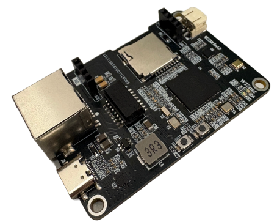

# WIZ-Cam

<p align="center">
  
</p>

WIZ-Cam 是一块基于 MicroPython 的开发板，运行在 **W55MH32** 上，搭载 **OV2640** 图像传感器和
**ICS-43434** I2S 麦克风。视频由 DMA 直接从传感器的 DVP 总线采集到 RAM，再通过芯片内置的 W5500 TCP/IP
核经以太网发送出去，可选择 **HTTP MJPEG 流** 或 **带音频的 RTSP/RTP**。音频也支持反向传输：PC 可以把 PCM
推流到开发板，由板载功放播放出来。

本项目并不是通用库：采集通路直接操作 TIM1、DMA1 和 GPIO 端口，因此引脚分配和寄存器地址都是 W55MH32 专用的。

## 硬件

### 规格

| | |
|---|---|
| MCU | W55MH32（Cortex-M3 @ 216 MHz，SPI2 上集成 W5500 TOE） |
| 传感器 | OV2640，DVP 8 位，JPEG 输出 |
| 麦克风 | ICS-43434，I2S（SPI3） |
| 功放 | MAX98357A，与麦克风位于**同一条** I2S 总线上 |

### 接线

OV2640
- VSYNC 接 `PC5`
- HREF 接 `PA8`（TIM1_CH1，用作计数器门控）
- PCLK 接 `PA12`（TIM1_ETR）
- D0-D7 接 `PA0-PA7`
- SCCB（I2C）接 `PB6`/`PB7`

音频
- SCK 接 `PB3`，WS 接 `PA15`，SD 接 `PB5`

麦克风和功放共用这三个引脚。芯片只有**一个** I2S 模块，而一个 I2S 模块只能工作在接收*或*发送模式，不能同时
兼顾——因此麦克风和扬声器无法同时工作。两者之间的切换通过运行时命令完成，见 [音频播放](#音频播放)。

## 软件
## 目录结构

```
main.py                 入口：根据 config.CAM_TYPE 选择 HTTP 还是 RTSP
rtsp_test.py            仅 RTSP 的测试脚本，比 main.py 更便于迭代调试
config.py               所有与板卡相关的配置（见下文）
i2c_test.py             SCCB 识别检查：读取 OV2640 的 PID
lib/                    各模块的源码
  _ov2640.py              Camera（采集 + HTTP）与 RTSPCamera（增加 RTP 推流）
  camera_setting.py       UDP 命令服务器对外暴露的传感器设置函数
  ov2640_regs.py          按分辨率生成的寄存器表
  ov2640_config.py        分辨率名称 -> 寄存器表
  mic.py                  ICS-43434 采集、RTP 打包，以及 MAX98357A 播放
  rtsp_server.py          RTSP 握手与 RTP 套接字
  server.py               用于实时修改设置的 UDP 命令服务器
*.mpy                   上述模块为开发板预编译的版本
```

一般来说，只要修改了 `lib/` 下的任何内容，都需要重新编译：

```
mpy-cross -march=armv7m -o _ov2640.mpy lib/_ov2640.py
```

`-march=armv7m` 是必需的——有多个函数使用了 `@micropython.viper` 和 `@micropython.native` 发射器，
缺少该参数将无法编译。

请确保系统中已安装 `mpy-cross`。

## 运行

1. 将 `.mpy` 文件、`main.py` 和 `config.py` 复制到开发板的文件系统中。
2. 按你的网络环境和所需传输方式修改 `config.py`。
3. 复位开发板并查看串口输出；它会打印出可供连接的地址。

在新硬件上，`i2c_test.py` 是第一个要运行的脚本——如果它没有报告预期的 PID，其余部分都不会正常工作。

### config.py

实际只会读取五类键值：

| | 读取方 | |
|---|---|---|
| `CAM_TYPE` | `main.py` | `0` = HTTP MJPEG，`1` = RTSP/RTP |
| `DRIVER` | `main.py`、`rtsp_test.py` | 要导入的传感器模块，形式为 `_<name>` |
| `DEBUG` | `_ov2640`、`mic`、`rtsp_server` | `True` 时打印每帧耗时、丢帧计数和 RTSP 交互过程 |
| `DHCP` | `setup.py` | 使用 DHCP，失败时回退到静态配置 |
| `NET_IP`/`NET_SN`/`NET_GW`/`NET_DNS` | `setup.py` | 静态地址 |

端口如下：

- HTTP：80
- RTSP：554
- UDP：5000
- 音频输入：6000

正常使用时请保持 `DEBUG = False`。这些报告是在帧与帧之间打印的，不会造成采集积压，但通过 USB 打印本身
仍会消耗若干毫秒。

---
### HTTP

浏览器访问 `http://<板卡IP>/`。开发板会返回 `multipart/x-mixed-replace`，浏览器会将其渲染为实时 MJPEG 流。

### RTSP

```
ffplay -i rtsp://<板卡IP>:554/
vlc rtsp://<板卡IP>:554/
```

视频为 RTP/JPEG（RFC 2435，载荷类型 26），端口 6100；音频为 8 kHz 单声道 L16（载荷类型 96），端口 6102。


**仅支持 UDP。** 请求通过 TCP 传输 RTP 的客户端（`Transport: RTP/AVP/TCP;interleaved=0-1`）会收到
`461 Unsupported Transport`，这会促使大多数客户端改用 UDP 重试。少数仅支持 TCP 的 Windows 播放器会直接失败。
另外请注意，运行在 WSL 中的客户端完全无法接收 RTP：RTSP 握手之所以成功，是因为 WSL2 对出站 TCP 做了 NAT，
但返回的 UDP 会被送到 Windows 宿主机上。

### 音频播放

开发板可以播放发送给它的音频，而不是推流自己采集的音频。由于只有一个 I2S 模块，这是一种切换而非叠加——
通过 UDP 命令服务器进行切换：

```
{"audio": 1}    扬声器模式：停止麦克风，播放到达 6000 端口的数据
{"audio": 0}    麦克风模式：恢复采集并向外推流音频
```

处于扬声器模式时，向 6000 端口发送 322 字节的 UDP 数据报：

| 偏移 | 大小 | 字段 |
|---|---|---|
| 0 | 2 | 序列号，`uint16` 大端 |
| 2 | 320 | 160 个采样点，`int16` 大端——20 ms 的 8 kHz 单声道音频 |

请以每秒 50 个的速率发送，并且**在静音期间也要持续发送**。开发板以固定速率从一个 120 ms 的环形缓冲区中
播放，从不等待，因此数据流中的空档就等于声音中的空档。

序列号决定了每个数据包落在环形缓冲区中的哪个位置，因此丢包和乱序是按位置而非到达顺序来处理的——这也正是
采用 UDP 的原因。一个在其时隙已经播放完毕之后才到达的数据包毫无用处，会被丢弃，而重传注定总是这么晚。

配置工具中的 `REC` 按钮可以在 PC 上用麦克风完成上述全部操作。

在扬声器模式期间，音频 RTP 仍会持续发往 RTSP 客户端并携带静音数据，这样客户端的音频时钟不会在扬声器工作
时停滞。

### UDP
`server.py` 在 `SERVER_PORT`（UDP）上监听并接收 JSON，因此可以在推流过程中重新调整传感器参数：

```
{"resolution": [800, 600]}
{"jpeg_quality": 12}
{"brightness": 1, "contrast": -1}
{"audio": 1}
```

图形界面工具位于 `rsc/WIZ-Cam Config Tools V2.exe`。

完整的键值集合就是 `lib/server.py` 顶部的那个字典：亮度、对比度、分辨率、翻转、JPEG 质量、饱和度、黑白模式、
曝光与增益控制、白平衡、镜头校正、特殊效果以及彩条测试图。


### 注意事项
1) 当前的 HTTP 流需要稳定的网络连接，因此建议与 PC 之间使用直连以太网。
若要在 DHCP 环境下观看 HTTP 流，你可能需要让客户端通过网线连接到路由器。
